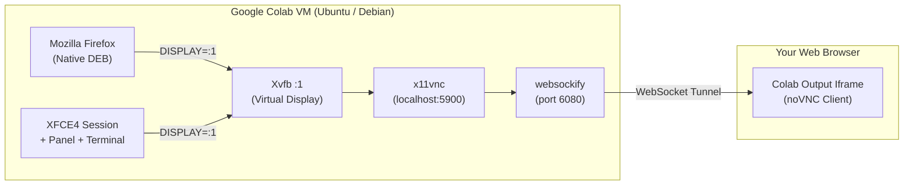

# 🖥️ colab-desktop

Run a complete Debian/Ubuntu XFCE4 desktop environment and native Mozilla Firefox directly inside Google Colab with one click.

[](https://colab.research.google.com/github/envblex/colab-desktop/blob/main/notebooks/colab-desktop.ipynb)
[](LICENSE)
[](https://github.com/envblex/colab-desktop)

---

## ✨ Features

* **⚡ One-Click Instant Launch**: Click the *Open in Colab* badge above, run the single cell, and your desktop appears in ~60 seconds.
* **🖼️ Embedded Web Window**: The interactive desktop is rendered directly inside the Colab notebook output via an HTML iframe (or in a new tab if you prefer full-screen).
* **🦊 Native Mozilla Firefox**: Uses the official Mozilla APT repository to install pure native DEB packages—completely bypassing the broken `snapd` daemon issue typical of Ubuntu Docker containers.
* **💸 100% Free Tier Compatible**: Runs flawlessly on standard Google Colab free CPU instances without requiring compute units or paid GPUs.
* **🌐 High-Speed Backbone**: Browse and download at Google Data Center network speeds (Gbps bandwidth).
* **📐 Configurable Resolution**: Select 720p, 1080p, or custom aspect ratios via Colab Form dropdowns.

---

## 🚀 Quick Start

1. Click the **[Open in Colab](https://colab.research.google.com/github/envblex/colab-desktop/blob/main/notebooks/colab-desktop.ipynb)** button above.
2. Select your desired resolution (default: `1280x720`).
3. Press **Run Cell** (`Shift + Enter`).
4. Interact with XFCE4 and Firefox directly inside the embedded notebook window!

---

## 🛠️ Architecture



---

## 📦 Manual Setup (Command Line)

If you are running in your own container or custom environment, you can run the setup script directly:

```bash
curl -fsSL https://raw.githubusercontent.com/envblex/colab-desktop/main/scripts/setup.sh | bash -s -- "1280x720" "true"
```

Arguments:
* `$1`: Resolution (e.g. `1280x720`, `1920x1080`)
* `$2`: Auto-launch Firefox (`true` or `false`)

---

## 🛡️ License

This project is licensed under the [MIT License](LICENSE).
